<div align="center">
  
</div>

<br>

> **Build things that compound.** Specific knowledge, long games, something small shipped every day.

I work where machine learning meets the living world: teaching computers to read an animal's movement and the shape of a blood cell.
<!-- TODO: 1–2 lines about you. Where you study/work, what you're aiming for.
     The banner's "now" list and newest projects update from profile.json and your repos automatically. -->

## Selected work

| Project | What it does | Stack |
| --- | --- | --- |
| [Mouse-Pose-Estimation](https://github.com/Bossgod360/Mouse-Pose-Estimation) | Pose estimation of mice for behavioural analysis | Python, SLEAP |
| [Identifying-Blood-Cells-CNN](https://github.com/Bossgod360/Identifying-Blood-Cells-CNN) | Convolutional network that classifies blood-cell images | Python, Jupyter |
<!-- TODO: add 1–2 more rows as your flagship projects land (live demo links are gold) -->

## Toolbox

```text
languages   Python · Java · Swift · HTML
ml          CNNs · pose estimation · data pipelines
practice    git · testing · writing things down
```
<!-- TODO: only list what you'd be happy to be quizzed on in an interview -->

## How I work

- Ship small, ship often.
- If it isn't documented, it doesn't exist.
- Read the source.
- Quiet confidence beats loud claims. Let the repos do the talking.

## Activity

<div align="center">
  <picture>
    <source media="(prefers-color-scheme: dark)" srcset="https://raw.githubusercontent.com/Bossgod360/Bossgod360/output/github-snake-dark.svg">
    
  </picture>
</div>

## Reach me

<!-- TODO: add your real links. Email is the most honest one. -->
[Email](mailto:you@example.com) · [LinkedIn](https://linkedin.com/in/your-handle) · [Website](https://your-site.dev)
