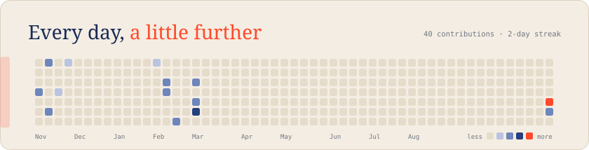

<!--
  Drawn by scripts/build_profile.py from profile.json + live GitHub data.
  Rebuilt every day by .github/workflows/update-hero.yml, so new repos,
  pushes, contributions and streaks appear on their own.
  Edit profile.json to change your text or add principles.
-->

  <a href="https://aryankhimani.com"><code>aryankhimani.com</code></a> &nbsp;·&nbsp;
  <!-- TODO: add your LinkedIn and uncomment:
  <a href="https://www.linkedin.com/in/YOUR-HANDLE"><code>linkedin</code></a> &nbsp;·&nbsp; -->
  <a href="https://github.com/Bossgod360?tab=repositories"><code>all repos</code></a>

